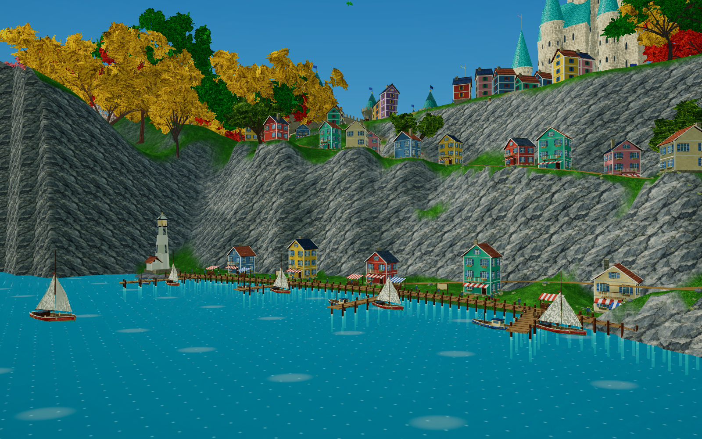

# Aurelia · Citadel of Falling Water

A local, single-player 3D fantasy exploration world built with Unity 6000.6.5f1 and URP. Explore the castle valley, colourful cliffside harbour, winding paths, forests, riverside cottage and sea-tree headland with an animated knight.

## Play

Download **Aurelia-Windows-x64.zip** from the [Windows release](https://github.com/Gubs2709/aurelia-castle-world/releases/tag/v0.8.1), extract the whole ZIP, and double-click **Play Reference Castle.cmd**. The game opens in borderless full screen at your desktop resolution and starts at the harbour. Unity Editor, Blender and Node.js are not needed to play.

From a source checkout, the same CMD can download the release automatically using an installed, authenticated GitHub CLI. This repository and its releases are private, so repository access is required. See [RUN.md](RUN.md) for setup and rebuild instructions.

WASD moves, Shift runs, Space jumps, mouse orbits and the wheel zooms. Escape pauses/releases the cursor; Alt+F4 quits. Press **5** for the harbour, **7** for the river retreat, **8** for the sea tree, and **P** for the castle vista.

## Source and assets

- `AureliaUnity/`: Unity project, saved scene `Assets/Scenes/ReferenceCastle.unity`, generated meshes, textures, shaders, models and animation clips.
- `SourceAssets/`: editable Blender review kits for the knight and V8 scenery.
- `tools/blender/` and `tools/texgen/`: original asset-generation scripts. Historical Blender scripts use D:/GAME output paths; adjust those before regenerating elsewhere.
- `docs/screenshots/`: actual Unity renders.
- `docs/validation/`: saved verification results.
- [HANDOFF_V8.md](HANDOFF_V8.md): detailed continuation notes and known visual limitations.
- [ASSET_PROVENANCE.md](AureliaUnity/ASSET_PROVENANCE.md): third-party asset sources and licenses. Generated artwork retains prompt manifests alongside the assets.

Open `AureliaUnity` in Unity **6000.6.5f1**, open `ReferenceCastle.unity`, then press Play. Use **Aurelia > Build Windows release (fullscreen)** to build the current scene. Dependencies are pinned in `AureliaUnity/Packages`. Local caches, machine settings, raw reference collections and built binaries are excluded from Git; the Windows build is distributed as a release asset.

## Current scope

The scene includes an animated 3D knight; varied tall forests; castle, city and waterfalls; 24 detailed coastal houses; five small landing stages; 13 ocean boats; a white lighthouse; decorative harbour residents; an arched river bridge, cottage and picnic; moving large/small clouds; a sea-tree headland and mountain backdrop. Harbour stair flights were replaced by winding paths. Runtime bloom is explicitly overridden to zero to remove the previous bright glare.

This is an exploration world. Interiors, quests, dialogue, progression, audio and saving are not implemented. The illustrations' exact composition, style and every incidental detail are not fully matched. Integrated-graphics performance remains untested. The earlier browser prototype is retained under `src/`, `public/` and `tests/`; its old instructions are in [docs/legacy-browser-readme.md](docs/legacy-browser-readme.md).
